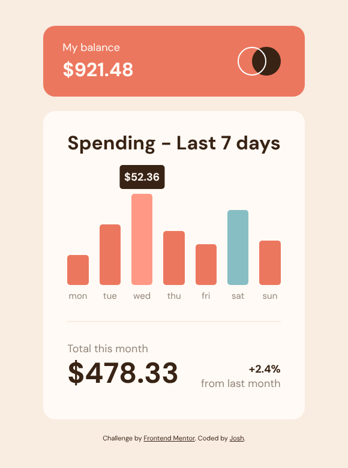

# Frontend Mentor - Expenses chart component solution

This is a solution to the [Expenses chart component challenge on Frontend Mentor](https://www.frontendmentor.io/challenges/expenses-chart-component-e7yJBUdjwt).

## Table of contents

- [Overview](#overview)
  - [The challenge](#the-challenge)
  - [Screenshot](#screenshot)
  - [Links](#links)
- [My process](#my-process)
  - [Built with](#built-with)
  - [What I learned](#what-i-learned)
  - [AI Collaboration](#ai-collaboration)
- [Author](#author)

## Overview

### The challenge

Users should be able to:

- View the bar chart and hover over the individual bars to see the correct amounts for each day
- See the current day's bar highlighted in a different colour to the other bars
- View the optimal layout for the content depending on their device's screen size
- See hover states for all interactive elements on the page
- **Bonus**: Use the JSON data file provided to dynamically size the bars on the chart

I also added:

- Keyboard support: each bar can be reached with Tab and shows its amount on focus
- Amounts stay in the DOM (hidden with `opacity`, not `display: none`), so screen readers can read them
- A friendly error message if the data fails to load

### Screenshot



### Links

- Solution URL: TODO
- Live Site URL: TODO

## My process

### Built with

- Semantic HTML5 markup (an ordered list for the bars)
- CSS custom properties
- CSS Grid
- Mobile-first workflow
- Vanilla JavaScript with ES modules (`import` / `export`)

### What I learned

**Pattern 1: JS calculates, CSS draws.** JavaScript works out one number per bar and hands it to CSS as a custom property; the stylesheet handles the height, colours and hover states. This keeps the JS small and all the visual rules in one place.

```js
// templates.js
`<li class="chart__item ${spending.day === day ? "is-today" : ""}" style="--h: ${ratio}%" tabindex="0">`
```

```css
.chart__bar { height: var(--h); }
```

**Pattern 2: scale data to the largest value.** In a bar chart the tallest bar fills the space and every other bar is a share of it, so the height is `amount / max × 100`. The maximum is read from the data rather than hard-coded, so the chart adapts to any set of numbers. I calculate it once per render and pass it in:

```js
const max = Math.max(...spendings.map((x) => x.amount));
const getRatio = ({ amount }, max) => (amount / max) * 100;
```

- `map` turns an array of objects into an array of numbers.
- The spread operator `...` passes those numbers to `Math.max`, which takes separate arguments rather than an array.
- Destructuring in the parameter list (`{ amount }`) picks out just the field the function needs.

**Pattern 3: a lookup array to convert formats.** `new Date().getDay()` returns a number from 0 (Sunday) to 6, while the data uses `"mon"`, `"tue"` and so on. A lookup array translates one format into the other, and the same trick works for months, status codes or any numbered list:

```js
const today = new Date().getDay(); // 6
const days = ["sun", "mon", "tue", "wed", "thu", "fri", "sat"];
days[today]; // "sat"
```

Because `Date` uses the visitor's own clock and time zone, the highlighted bar always matches their day.

**Pattern 4: values for people vs. values for code.** `formatPrice()` turns a number into `$52.36` for the tooltip, while the bar height stays a plain number for CSS. Keeping display formatting at the very end means the raw data stays easy to calculate with.

**Pattern 5: accessible hover content.** The tooltips are hidden with `opacity: 0` instead of `display: none`, so screen readers still read each amount. Each bar has `tabindex="0"`, and the CSS shows the tooltip on both `:hover` and `:focus-visible`, so keyboard users get the same information as mouse users.

### AI Collaboration

I use AI as a learning partner to code better, not to skip the learning:

- Used Claude Code to write the HTML and CSS skeleton.
- Used Claude Code to explain the reasoning behind the skeleton's structure.
- Used AI to analyze the product scenario and the key points of the design.
- Wrote all of the JavaScript myself.
- Used AI to build a project notebook, where I manually fill in before, during and after notes (design analysis and planned JS flow, every blocker sorted by type, and a final review compared with similar projects) to organize my thinking, summarize the development process, and correct the mistakes I keep making.

## Author

- Website - [Josh Liu](https://my-portfolio-frontend-kappa-lemon.vercel.app/)
- Frontend Mentor - [@JoshLiu111](https://www.frontendmentor.io/profile/JoshLiu111)
